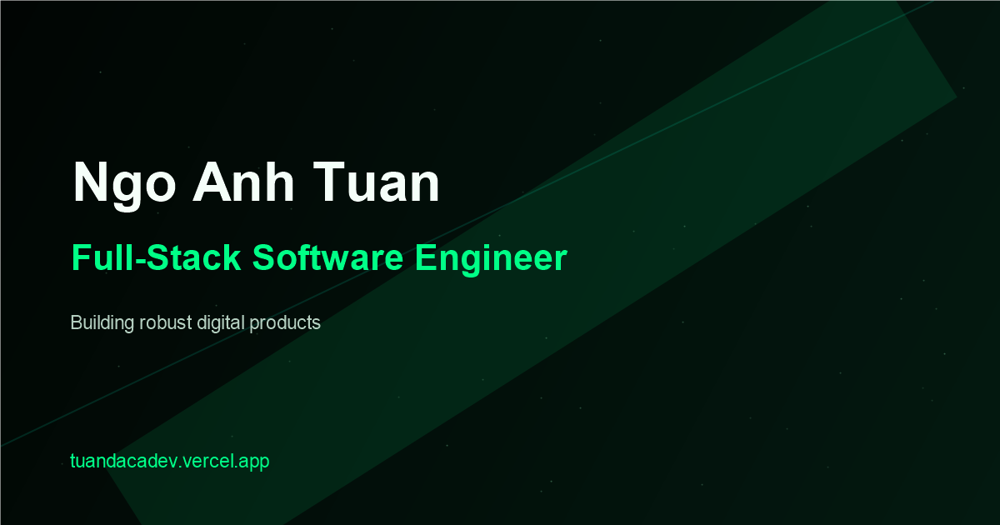

# Ngo Anh Tuan — Full-Stack Software Engineer Portfolio

Full-Stack Software Engineer portfolio focused on backend systems, modern web applications, and AI-integrated experiences.

[Live Portfolio](https://tuandacadev.vercel.app/) · [GitHub](https://github.com/Tuandaca)



## Overview

A performance-focused interactive portfolio built with React, TypeScript, Three.js, and p5.js.

It combines a binary force-field hero, a procedural WebGL environment, adaptive rendering, responsive layouts, and a serverless contact system, while keeping accessibility and performance as first-class concerns.

## Highlights

- **Binary ForceField hero** — p5.js particle field driven by cursor physics, with spatial-grid lookup, spring restoration, and a pre-rendered glyph atlas.
- **DEV.NETWORK Three.js scene** — procedural WebGL core with a custom fresnel glow shader and a static fallback for unsupported hosts.
- **Coordinated canvases** — p5.js and Three.js are mutually exclusive and crossfade on scroll instead of competing for the GPU.
- **Semantic accent system** — Neon green as the primary accent, with cyan, violet, and amber reserved for specific categories.
- **Adaptive rendering** — quality tiers scale DPR and particle counts from measured frame timings and device capability.
- **Responsive layout** — verified from 375 px to 1920 px, including navigation density and touch target sizes.
- **Accessibility** — `prefers-reduced-motion` handled at runtime, visible focus rings, landmark and heading hierarchy, labelled controls.
- **Contact API** — serverless endpoint with Resend delivery, rate limiting, honeypot, timing trap, and input sanitization.
- **SEO and prerendering** — static markup injected at build time, plus Open Graph, Twitter, JSON-LD, `robots.txt`, and `sitemap.xml`.

## Tech Stack

| Layer | Stack |
|---|---|
| Frontend | React 18 · TypeScript · Vite · Tailwind CSS |
| Interactive | Three.js · p5.js · WebGL · custom GLSL shaders |
| Backend / Platform | Vercel Serverless Functions · Resend |
| Quality | Node test runner · headless Chrome QA scripts · responsive QA · reduced motion |

## Featured Projects

### Travel AI — GraphRAG & Knowledge Graph Q&A

Tourism Q&A for Ho Chi Minh City. FastAPI combines sentence embeddings with Neo4j vector index and Cypher keyword search, then passes retrieved place-node content to Gemini.

`Python` · `FastAPI` · `Neo4j` · `sentence-transformers` · `Gemini`
[Repository](https://github.com/Tuandaca/DACNTT)

### Cinema — Movie Booking & AI Recommendation

Booking platform with Redis-backed seat holds, Socket.IO seat updates, NestJS booking and order flows, Stripe payment intents, and a Gemini-powered catalog assistant.

`Next.js` · `TypeScript` · `NestJS` · `PostgreSQL` · `Prisma` · `Redis` · `Socket.IO`
[Repository](https://github.com/Tuandaca/cinema)

### AI Coding Starter

Python project wizard with 21+ tech stack presets, a generated context file, and setup scripts for starting AI-assisted development.

`Python` · `CLI` · `Project scaffolding`
[Repository](https://github.com/Tuandaca/AI-Coding-starter)

### Gaming Mouse — Product Landing Page

Responsive product landing showcase with hover-driven cards, specifications, and feature highlights.

`React 18` · `TypeScript` · `Vite` · `Tailwind CSS` · `Radix UI`
[Repository](https://github.com/Tuandaca/gamingmouse) · [Live](https://gamingmouse.lovable.app/)

## Architecture & Performance

- **Code-split heavy renderers.** `three` and `p5` are emitted as separate vendor chunks and excluded from the initial HTML module preload path.
- **Canvas coordinator.** `useCanvasCoordinator` derives p5 and WebGL opacity and activity from normalized scroll progress, crossfading between them and pausing both when the tab is hidden.
- **Adaptive quality engine.** `useAdaptiveQuality` selects from five presets (`ultra`, `high`, `medium`, `low`, `reduced-motion`) using device heuristics, then adjusts from a filtered FPS average with hysteresis, a cooldown window, and a downgrade cap to avoid oscillation.
- **WebGL fallback.** Hosts without usable WebGL render `FallbackBackground` instead of an empty canvas.
- **Visibility and motion handling.** Hidden tabs and reduced-motion preferences stop the render loops rather than leaving them running at zero opacity; both resume cleanly when the condition clears.
- **Prerendering.** `scripts/prerender.mjs` injects the rendered markup into `dist/index.html` so crawlers receive content before hydration.

## Project Structure

```
src/
├── components/
│   ├── DevNetwork/          # Three.js scene, shaders, fallback
│   ├── ContactSection.tsx   # Form, validation, submission states
│   ├── CyberCursor.tsx      # Fine-pointer cursor overlay
│   ├── ErrorBoundary.tsx    # Canvas/UI failure isolation
│   └── GalaxyBackground.tsx # Procedural background layer
├── hooks/
│   ├── useAdaptiveQuality.ts
│   ├── useCanvasCoordinator.ts
│   ├── useScrollReveal.tsx
│   └── useScrollStoryteller.ts
├── App.tsx                  # Page sections and content
├── Component.tsx            # p5.js ForceFieldBackground
├── index.css                # Design tokens, motion, utilities
└── main.tsx                 # React root

api/
└── contact.ts               # POST /api/contact serverless function

scripts/                     # Prerender, OG card, QA and profiling helpers
tests/                       # Node unit tests and browser checks
docs/                        # API, QA, ForceField, and planning docs
```

## Getting Started

```bash
git clone https://github.com/Tuandaca/PersionalWebsite.git
cd PersionalWebsite
npm install
npm run dev
```

The dev server runs on `http://localhost:5173` and mounts a local `/api/contact` handler, so the form works without Vercel or a Resend key.

## Build

```bash
npm run build     # tsc + vite build + prerender
npm run preview   # serve the production build
```

`dist/` is generated and excluded from version control.

## Documentation

- [Contact API specification](./docs/contact-api.md)
- [ForceField background reference](./docs/force-field.md)
- [Portfolio regression QA](./docs/qa/2026-11-04-portfolio-regression.md)

## Contact

- Portfolio: [tuandacadev.vercel.app](https://tuandacadev.vercel.app/)
- GitHub: [github.com/Tuandaca](https://github.com/Tuandaca)
- Email: [ngoanhtuan23.it@gmail.com](mailto:ngoanhtuan23.it@gmail.com)
